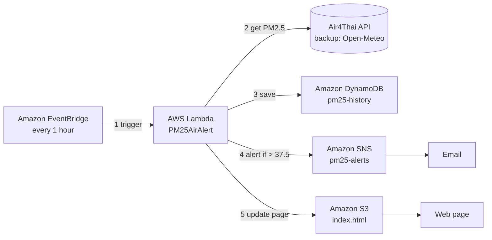

# PM2.5 Air Alert

**Team AirConnect · Section 427B · CS446/IT332 Cloud Computing, Bangkok University**
Sakolwat Jessadaaphiban (1660700673) · Matika Noynin (1660704774)

Every hour, this system checks the Bangkok PM2.5 level from the free Air4Thai API, saves it in a history table, emails an alert when the air is unhealthy (over 37.5 µg/m³, the Thai standard), and updates a public web page.

> *ภาษาไทย: ระบบเช็คค่าฝุ่น PM2.5 กรุงเทพฯ ทุกชั่วโมง เก็บประวัติ ส่งอีเมลเตือนเมื่อเกิน 37.5 และอัปเดตหน้าเว็บอัตโนมัติ*

## Architecture



| AWS service (counted) | Job | Name we use |
|---|---|---|
| Amazon EventBridge | Runs Lambda every hour | `pm25-hourly` · `rate(1 hour)` |
| AWS Lambda (Python) | Reads the API, decides, writes results | `PM25AirAlert` |
| Amazon DynamoDB | PM2.5 history | `pm25-history` |
| Amazon SNS | Email alert | `pm25-alerts` |
| Amazon S3 | Public web page | `pm25-page-…` |

External data: [Air4Thai](https://air4thai.pcd.go.th) (Pollution Control Department), station `50t` Chulalongkorn Hospital. If it fails, the code uses [Open-Meteo Air Quality](https://open-meteo.com/en/docs/air-quality-api) automatically. No API key needed.

---

## Step-by-step deployment guide (about 60 minutes)

**You need:** an AWS Academy Learner Lab and an email address. All names below can stay the same, because every Learner Lab is a separate account. You only change **your own email** in step 1.6.

> *ภาษาไทย: ทำตามได้เลย เปลี่ยนแค่อีเมลของตัวเองในข้อ 1.6 ชื่ออื่นใช้เหมือนเราได้ทั้งหมด*

### 0. Start
1. AWS Academy → your course → **Modules** → **Launch AWS Academy Learner Lab** → **Start Lab**. Wait for the green dot → click **AWS**.
2. Top right: region must be **N. Virginia (us-east-1)**.

### 1. SNS (email alert)
1. Search → **SNS** → **Simple Notification Service**.
2. Left menu → **Topics** → **Create topic**.
3. Type: **Standard** *(ภาษาไทย: ต้องเป็น Standard, FIFO ส่งอีเมลไม่ได้)*.
4. Name: `pm25-alerts` → **Create topic**.
5. Tab **Subscriptions** → **Create subscription**.
6. Protocol: **Email** · Endpoint: **your email** → **Create subscription**.
7. Open your email → “AWS Notification - Subscription Confirmation” → click **Confirm subscription** *(ภาษาไทย: ถ้าไม่เจอ ดูใน Spam/Junk)*.
8. Back in SNS → refresh until Status = **Confirmed**.

✅ Subscription status is **Confirmed**.

### 2. DynamoDB (history table)
1. Search → **DynamoDB** → **Tables** → **Create table**.
2. Table name: `pm25-history` · Partition key: `station` (String) · Sort key: `checked_at` (String).
3. Table settings: **Default settings** → **Create table**.
4. Wait until Status = **Active**.

✅ Table `pm25-history` is **Active**.

### 3. S3 (public web page)
1. Search → **S3** → **Create bucket**.
2. Bucket type: **General purpose** · Bucket namespace: **Account Regional namespace** · Bucket name prefix: `pm25-page`.
   (No namespace option? Use a full name that starts with `pm25-page`, for example `pm25-page-yourteam-2026`.)
3. Block Public Access: **uncheck** “Block all public access”, tick **I acknowledge** *(ภาษาไทย: ต้องปิด เพราะหน้าเว็บต้องเปิดให้ทุกคนดูได้)*.
4. **Create bucket**.
5. Click the bucket → tab **Permissions** → check “Block all public access” = **Off**.
6. Bucket policy → **Edit** → paste the policy below. Replace `PASTE-BUCKET-ARN-HERE` with the **Bucket ARN** shown above the editor, and keep `/*` at the end → **Save changes**.

```json
{
  "Version": "2012-10-17",
  "Statement": [
    {
      "Sid": "PublicReadGetObject",
      "Effect": "Allow",
      "Principal": "*",
      "Action": "s3:GetObject",
      "Resource": "PASTE-BUCKET-ARN-HERE/*"
    }
  ]
}
```

✅ Policy saves with no error and the bucket shows **Publicly accessible**.

### 4. Lambda (the code)
1. Search → **Lambda** → **Create function**.
2. **Author from scratch** · Function name: `PM25AirAlert` · Runtime: **Python 3.12** (or newest Python 3).
3. **Additional settings** / **Change default execution role** → **Use an existing role** → **LabRole** → **Create function** *(ภาษาไทย: Learner Lab สร้าง role ใหม่ไม่ได้ ต้องใช้ LabRole)*.
4. Tab **Code** → open `lambda_function.py` → select all, delete → paste the whole file [`lambda_function.py`](lambda_function.py) from this repo.
5. Click **Deploy** *(ภาษาไทย: แก้โค้ดทุกครั้งต้องกด Deploy ก่อน Test)*.
6. Tab **Configuration** → **General configuration** → **Edit** → Timeout **0 min 30 sec** → **Save**.

No environment variables are needed. The code finds the bucket by the prefix `pm25-page` and the topic by the name `pm25-alerts`.

### 5. EventBridge (every hour)
1. Lambda page → **Function overview** → **+ Add trigger**.
2. Source: **EventBridge (CloudWatch Events)**.
3. Rule: **Create a new rule** · Rule name: `pm25-hourly` · Rule type: **Schedule expression** · `rate(1 hour)` → **Add** *(ภาษาไทย: hour ไม่มี s)*.

✅ Configuration → Triggers lists **pm25-hourly**, Enabled.

### 6. Test
1. Tab **Test** → **Create new event** · Event name `ManualRun` · Event JSON `{}` → **Save** → **Test**.
   ✅ “Executing function: succeeded”, response shows `pm25`, `place`, `source`.
2. DynamoDB → **Explore items** → `pm25-history` → **Run**. ✅ One new row.
3. S3 → bucket → `index.html` → open the **Object URL**. ✅ “PM2.5 Air Alert · Bangkok” page with a coloured number.
4. Test the email: new test event `AlertTest` with JSON `{"test_limit": 5}` → **Test**. ✅ Email “PM2.5 Alert: … ug/m3 in Bangkok” arrives *(ภาษาไทย: test_limit 5 คือหลอกเกณฑ์ให้ต่ำ เพื่อทดสอบอีเมล ของจริงใช้ 37.5)*.
5. Run `ManualRun` once more to put the real limit (37.5) back on the page.
6. Wait about 1 hour → DynamoDB has a new row that nobody clicked. ✅ Automation works.

### If something fails

| Error message | Fix |
|---|---|
| `Task timed out` | Set the Lambda timeout to 30 sec (step 4.6). |
| `No S3 bucket starts with pm25-page` | Bucket name must start with `pm25-page`. |
| `No SNS topic named pm25-alerts` | Topic name must be exactly `pm25-alerts`. |
| `ResourceNotFoundException` | Table name must be `pm25-history` and Active. |
| `AccessDenied` (Lambda) | Execution role must be **LabRole**. |
| AccessDenied XML on the web page | Bucket policy missing, or `/*` missing at the end. |
| No email | Subscription not Confirmed, or check Spam. |
| `source` is Open-Meteo | Not an error: Air4Thai was down, backup was used. |

### Clean up (after demo day only)
Lambda → delete `PM25AirAlert` · EventBridge → Rules → delete `pm25-hourly` · DynamoDB → delete `pm25-history` · S3 → **Empty** then **Delete** the bucket · SNS → delete topic `pm25-alerts` · Sign out → **End Lab**.

---

## Files
- [`lambda_function.py`](lambda_function.py): the whole Lambda function (Python 3, only built-in libraries + boto3).
- [`architecture.png`](architecture.png): AWS architecture diagram.
